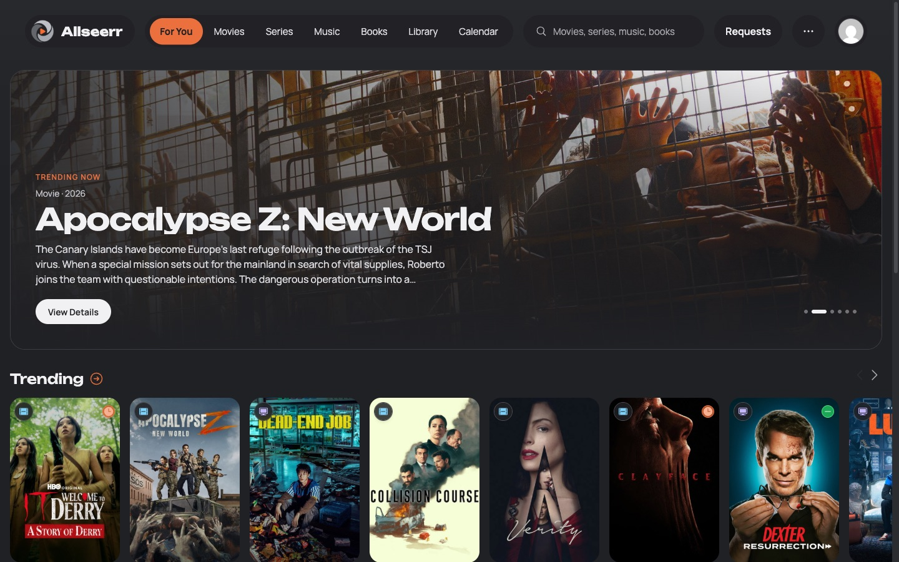
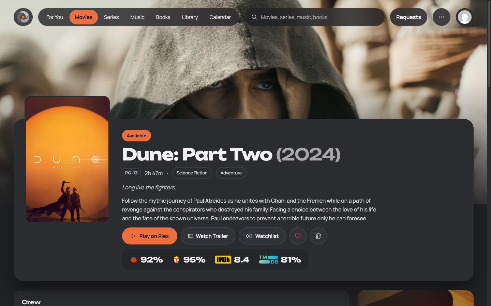
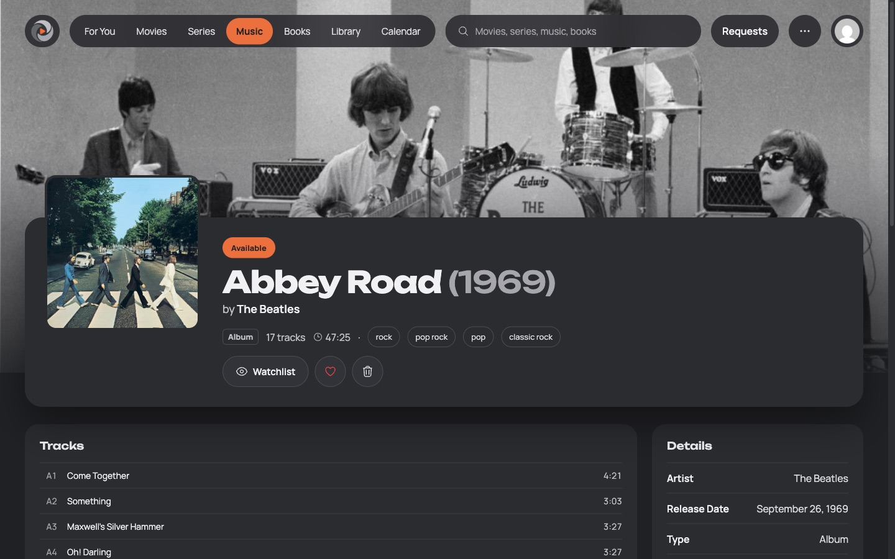
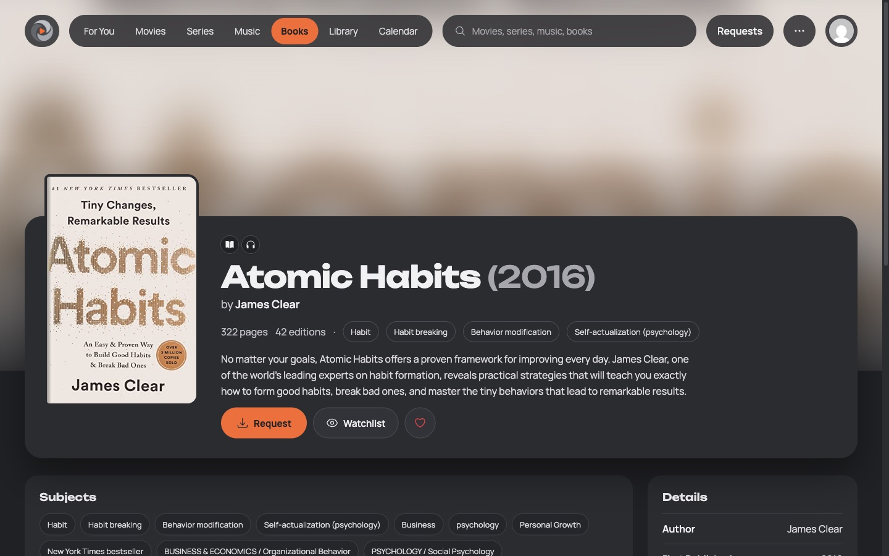
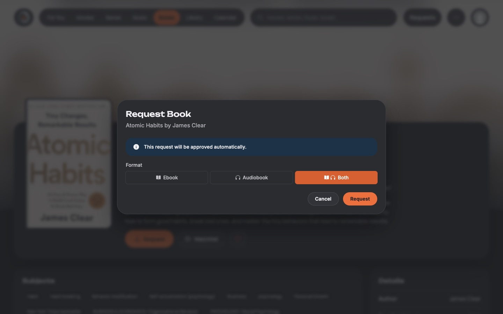
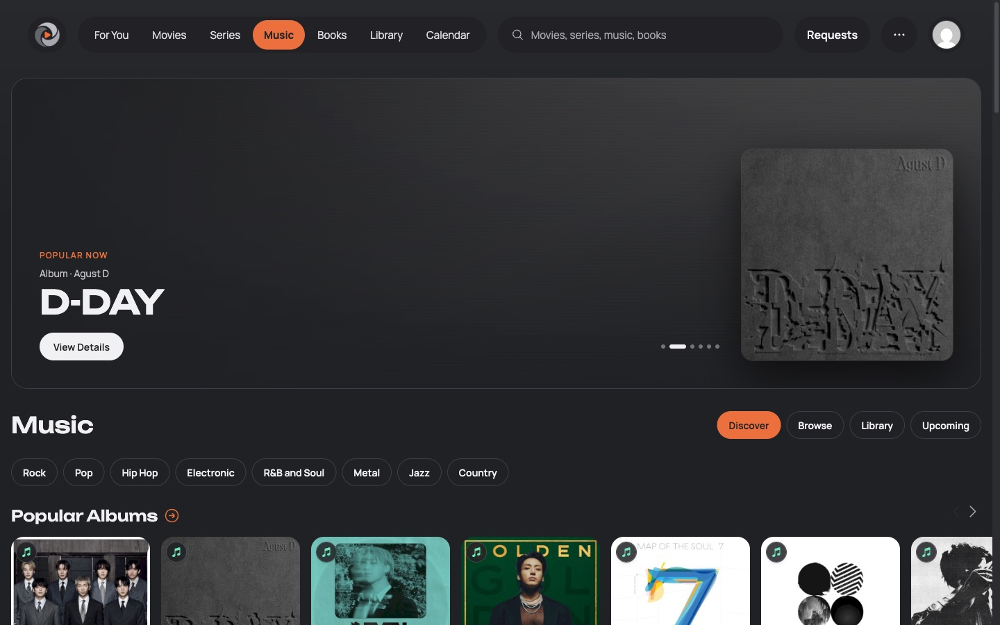
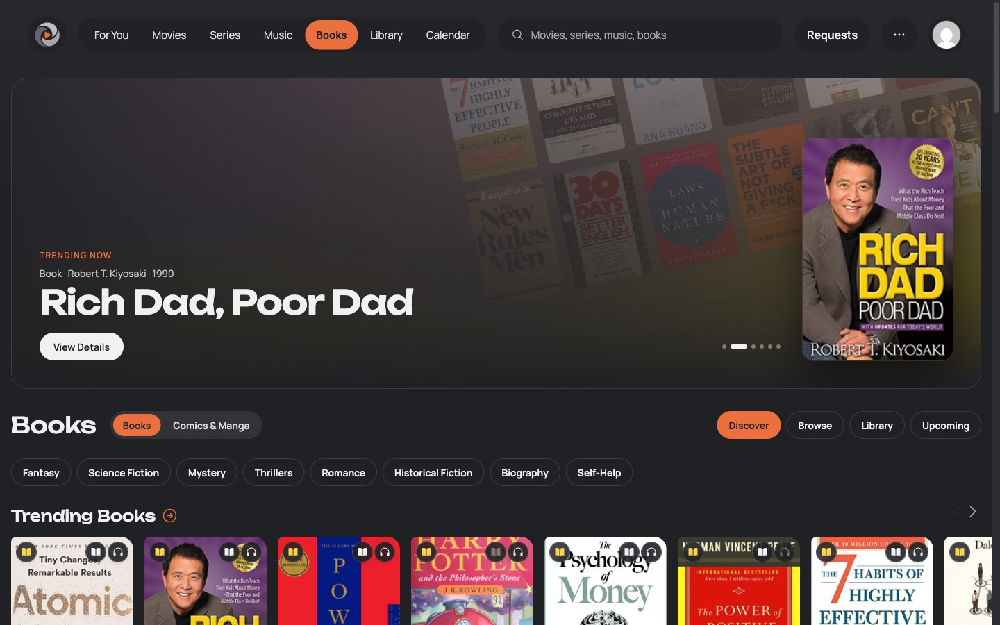
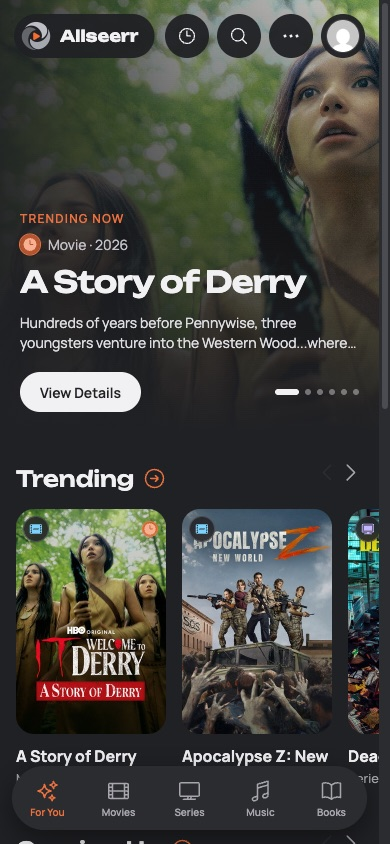
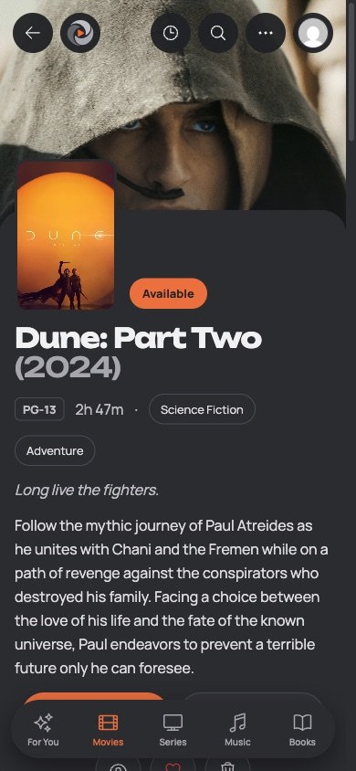

<p align="center">

</p>

# Allseerr

**Allseerr** is a free and open source request manager for your media library: movies, series, **music**, **books** and **audiobooks** in one place, plus a **subtitles** panel. It works with [Jellyfin](https://jellyfin.org), [Plex](https://plex.tv) and [Emby](https://emby.media/), and sends requests to [Radarr](https://radarr.video/), [Sonarr](https://sonarr.tv/), [Lidarr](https://lidarr.audio/) and Chaptarr.

Allseerr is a fork of [Seerr](https://github.com/seerr-team/seerr). It keeps everything Seerr does and adds the features below.

## Features

Everything from Seerr: Jellyfin, Emby and Plex sign in and library sync, Radarr and Sonarr requests, a granular permission system, request limits, override rules, watchlist and blocklist, many notification agents, and SQLite or PostgreSQL. On top of that:

### Music

- Album requests through **Lidarr**, with album and artist pages, discography requests and per-user music request limits.
- Metadata from **MusicBrainz**, **Cover Art Archive**, **TheAudioDB** and **ListenBrainz**: popular albums, new releases, popular artists, genre shelves and similar artists.
- Availability from Lidarr and from Plex, Jellyfin and Emby music libraries.

### Books and audiobooks

- One title with two formats: users request the **ebook**, the **audiobook** or **both**, and each format has its own status.
- Requests go to **Chaptarr** (a Readarr fork). **LazyLibrarian** is supported as a legacy book service.
- Per-language book requests, with Chaptarr tags and release profiles that keep downloads in the chosen language.
- Download progress for each format, and admin release actions (search again, grab a release, replace a file).
- Ebook existence check through **Google Books** (optional API key), audiobook existence check, narrators and length from **Audible's** public catalog.
- **Audiobookshelf** links that open the book itself, with separate ebook and audiobook libraries and a read-only API key.
- Custom book subject rows on the home page.

### Subtitles

- A **Bazarr** panel on movie and series pages: downloaded, wanted and missing languages, and requesting another subtitle language.

### Requests

- Single-episode, future-seasons-only and **current-season-only** series requests.
- **Removal requests** with approval, for movies, series, albums and books.
- Decline with a reason, auto-approve rules and per-user age rating limits.
- Block requests for titles included with chosen streaming subscriptions.

### Discover and notifications

- A For You home, a space each for movies, series, music and books, and a release calendar.
- Follow artists and authors and hear about their new releases.
- A weekly **Recently Added** newsletter email, notifications when new episodes arrive, and alerts when a library scan keeps failing.
- Plex connection handling that understands reverse proxies and Cloudflare.

### Interface

- **Ambient**, a redesigned interface (the default), and the classic interface, switchable from the user menu.
- A **guided tour** for first-time users.
- Your own name, logo and accent color, with generated app icons and iOS launch screens.
- **Personal API keys** for every user.

## Screenshots



| | |
| --- | --- |
|  |  |
| Movies and series | Albums from Lidarr |
|  |  |
| Books and audiobooks | Request an ebook, an audiobook or both |
|  |  |
| A space for music | A space for books, comics and manga |

<p>
  
  &nbsp;
  
</p>

## Install

Allseerr is published as a Docker image: `ghcr.io/dancue44/allseerr:latest`. It listens on port `5055` and keeps all of its data in `/app/config`. The container runs as UID 1000 and needs `--init`.

### Docker run

```bash
mkdir -p /path/to/appdata/allseerr
chown -R 1000:1000 /path/to/appdata/allseerr

docker run -d \
  --name allseerr \
  --init \
  -e TZ=America/New_York \
  -p 5055:5055 \
  -v /path/to/appdata/allseerr:/app/config \
  --restart unless-stopped \
  ghcr.io/dancue44/allseerr:latest
```

### Docker Compose

```yaml
services:
  allseerr:
    image: ghcr.io/dancue44/allseerr:latest
    container_name: allseerr
    init: true
    environment:
      - TZ=America/New_York
    ports:
      - 5055:5055
    volumes:
      - /path/to/appdata/allseerr:/app/config
    healthcheck:
      test: wget --no-verbose --tries=1 --spider http://localhost:5055/api/v1/settings/public || exit 1
      start_period: 20s
      timeout: 3s
      interval: 15s
      retries: 3
    restart: unless-stopped
```

Then open `http://<your-server>:5055` and follow the setup wizard.

### Unraid

Search for **Allseerr** in the **Apps** tab (Community Applications) and install the template.

More options (PostgreSQL, Windows, building from source, reverse proxies) are in the [docs](./docs).

## Migrating from Seerr, Overseerr or Jellyseerr

1. **Back up first.** Stop the old container and copy its config folder.
2. Start Allseerr with the copy mounted at `/app/config`. Allseerr migrates the database and settings forward on first start, so your users, requests and settings carry over.
3. Going back to Seerr (or Overseerr or Jellyseerr) **on the same database is not supported**, so keep the backup until you are sure.

See the [migration guide](./docs/migration-guide.mdx) for details.

## Update channels

| Tag | Channel |
|---|---|
| `latest` | The newest release, for amd64 and arm64. Recommended. |
| `main` | Every change merged to `main` between releases (amd64). |
| `develop` | Testing builds of upcoming changes (amd64). |

Allseerr versions are the Seerr release they are based on plus an Allseerr revision, for example `3.5.0.2`. See [update channels](./docs/getting-started/update-channels.mdx).

## Supported services

| Area | Services |
|---|---|
| Media servers | Plex, Jellyfin, Emby |
| Movies and series | Radarr, Sonarr (v3 and v4) |
| Music | Lidarr |
| Books and audiobooks | Chaptarr (recommended), other Readarr compatible servers, LazyLibrarian (legacy) |
| Audiobook and ebook links | Audiobookshelf |
| Subtitles | Bazarr |
| Watch history | Tautulli |
| Notifications | Email, web push, Discord, Slack, Telegram, Pushover, Pushbullet, Gotify, ntfy, webhooks |

## Outbound connections and privacy

Allseerr has **no telemetry, analytics or tracking**. It talks to your own services (media server, Radarr, Sonarr, Lidarr, Chaptarr, LazyLibrarian, Audiobookshelf, Bazarr, Tautulli) and to the public services below, only for the features that need them:

| Service | When |
|---|---|
| **TMDB** (`api.themoviedb.org`, `image.tmdb.org`) | Always: movie and series metadata, search and images. Browsers load TMDB images directly unless image caching is enabled. |
| **plex.tv** (`plex.tv`, `discover.provider.plex.tv`) | When you use Plex: sign in with Plex, server discovery and Plex watchlists. |
| **GitHub** (`api.github.com`) | When **Version Check** is enabled (the default): checks for new Allseerr releases. |
| **MusicBrainz** (`musicbrainz.org`) | Music features: search, albums, track lists, artists and artist summaries (MusicBrainz serves the Wikipedia extract). |
| **Cover Art Archive** (`coverartarchive.org`, `archive.org`) | Music features: album covers. |
| **TheAudioDB** (`www.theaudiodb.com`) | Music features: artist images and biographies, with the free public key. |
| **ListenBrainz** (`api.listenbrainz.org`, `labs.api.listenbrainz.org`) | Music features: popular albums and new releases, and similar artists from its labs `similar-artists` endpoint. |
| **OpenLibrary** (`openlibrary.org`, `covers.openlibrary.org`) | Book features: search, books, authors, subjects and covers. |
| **Audible** (`api.audible.com`, or the store for your Discover Region; covers from `m.media-amazon.com`) | Book features: whether an audiobook edition exists, narrators and length. Public catalog, no account. |
| **Google Books** (`www.googleapis.com`) | Only when you enter a Google Books API key: whether an ebook edition exists. |
| **Rotten Tomatoes** (through Algolia) and **IMDb** ratings (through `api.radarr.video`) | Ratings on movie and series pages, as in Seerr. |
| **TheTVDB** (`api4.thetvdb.com`) | Only when you pick TheTVDB as a metadata provider. |
| **Anime-Lists** (`raw.githubusercontent.com`) | Plex scans, to match anime, as in Seerr. |
| **Gravatar** | Avatars for users without a media server avatar. |
| **Google** (`www.google.com`) | Only when an HTTP(S) proxy is configured: a connection test through the proxy. |
| **Notification services** | Only the agents you enable (Discord, Slack, Telegram, Pushover, Pushbullet, Gotify, ntfy, webhooks, your SMTP server, browser push services). |

MusicBrainz and OpenLibrary see requests identified as `Allseerr/<version>` with a link to this repository, as their usage policies ask. No user data is sent to the metadata services. Cloudflare's IP ranges, used to recognize Plex addresses behind Cloudflare, are built in and are never downloaded.

## Support

Report bugs and ask for features at [github.com/DanCue44/Allseerr/issues](https://github.com/DanCue44/Allseerr/issues). Please do not report Allseerr problems to the Seerr team.

## About this project

Allseerr started as a fork of Seerr that I built for my own use, with the help of AI. Many people have asked for music and book support, and I felt bad keeping all of this to myself, so I decided to share it. I will maintain it and keep improving it as I have time.

See [ROADMAP.md](./ROADMAP.md) for what is done and what is planned.

## Credits

Based on [Seerr](https://github.com/seerr-team/seerr) by the Seerr team, MIT licensed. Seerr brought together [Overseerr](https://github.com/sct/overseerr) and Jellyseerr. Allseerr is not affiliated with or endorsed by the Seerr team.

Music metadata comes from MusicBrainz, Cover Art Archive, TheAudioDB and ListenBrainz, and book metadata from OpenLibrary. Thank you to all of these projects.

## License

[MIT](./LICENSE). The original copyright notice is kept in the license file.
